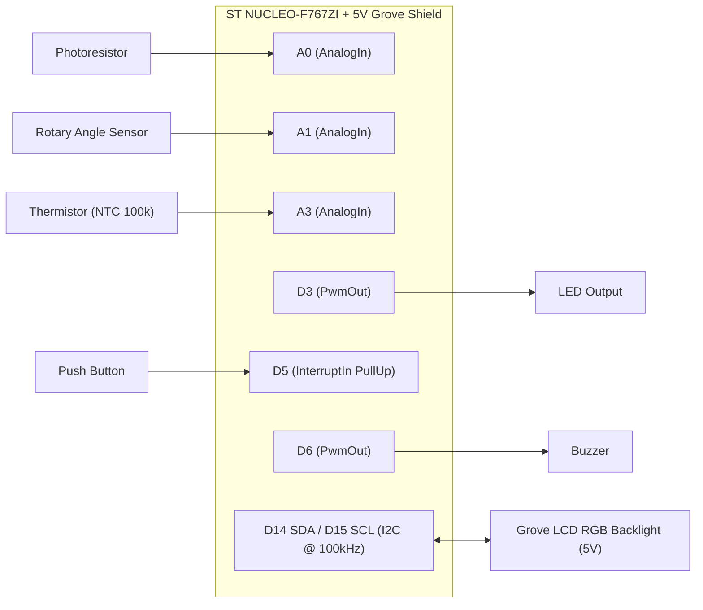
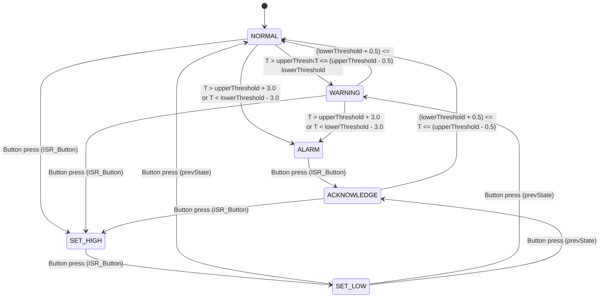

# Embedded Environmental Monitor & Control System (ST NUCLEO-F767ZI)

An **Mbed OS 6** embedded application for the **ST NUCLEO-F767ZI** development board (with a 5V Grove Shield) developed for the *Embedded and Mobile Applications (AME26_27)* mandatory exercise.

The system continuously monitors **ambient temperature** and **ambient light**, controls artificial **LED illumination via PWM**, manages **warning/alarm conditions through a Finite State Machine (FSM)** with **hysteresis**, provides **audible buzzer alerts**, allows **interactive threshold configuration** via a push button and rotary angle sensor, and displays live status on a **16×2 Grove RGB LCD** over I²C.

---

## Table of Contents

- [Repository Structure](#repository-structure)
- [Hardware & Connection Schematics](#hardware--connection-schematics)
- [System Architecture & Functioning](#system-architecture--functioning)
  - [1. Sensor Acquisition & Filtering](#1-sensor-acquisition--filtering)
  - [2. Temperature Sensing (`Thermistor`)](#2-temperature-sensing-thermistor)
  - [3. Light Sensing & PWM Illumination (`Photoresistor`)](#3-light-sensing--pwm-illumination-photoresistor)
  - [4. Finite State Machine (FSM)](#4-finite-state-machine-fsm)
  - [5. Threshold Configuration (`SET_HIGH` / `SET_LOW`)](#5-threshold-configuration-set_high--set_low)
  - [6. Audible Buzzer Alerts](#6-audible-buzzer-alerts)
  - [7. Grove RGB LCD (I²C)](#7-grove-rgb-lcd-i2c)
- [Serial Debug Output](#serial-debug-output)
- [Building & Flashing](#building--flashing)
- [Troubleshooting & Known Notes](#troubleshooting--known-notes)

---

## Repository Structure

```text
.
├── main.cpp                                  # Main application, FSM, ISRs, PWM & LCD updates
├── mbed_app.json                             # Mbed OS config (enables std printf library)
├── mbed-os.lib                               # Mbed OS 6 library reference
├── Grove_LCD_RGB_Backlight/
│   ├── Grove_LCD_RGB_Backlight.h             # Grove 16x2 RGB LCD I2C driver header
│   └── Grove_LCD_RGB_Backlight.cpp           # Grove 16x2 RGB LCD I2C driver implementation
├── Photoresistor/
│   ├── Photoresistor.h                       # Light sensor (photoresistor) class header
│   └── Photoresistor.cpp                     # Lux calculation & scaling
├── Thermistor/
│   ├── Thermistor.h                          # NTC thermistor class header
│   └── Thermistor.cpp                        # Beta-parameter temperature calculation
├── LCD Specifications-1.pdf                  # Course LCD API reference
└── [AME2627] - EMBEDDED MANDATORY EXERCISE.pdf # Course assignment specification
```

---

## Hardware & Connection Schematics

### Required Components

- **ST NUCLEO-F767ZI** development board (ARM Cortex-M7, 3.3 V MCU with 5 V-tolerant I/O on I²C pins)
- **5V Grove Base Shield** (Arduino Uno R3 header compatible)
- **Grove Temperature Sensor** (NTC Thermistor, $R_0 = 100\text{ k}\Omega$, $\beta = 4250$)
- **Grove Light Sensor** (Photoresistor)
- **Grove Rotary Angle Sensor** (Potentiometer)
- **Grove Button** (Active-low with internal `PullUp`)
- **LED** (PWM-driven output stage)
- **Standard Buzzer** (PWM-driven)
- **Grove - LCD RGB Backlight** (16×2 character LCD + RGB backlight over I²C)

### Pinout Mapping

| Peripheral | Shield / Arduino Pin | Mbed Class | Direction / Mode | Notes |
| :--- | :--- | :--- | :--- | :--- |
| **Photoresistor (Light)** | `A0` | `AnalogIn` | Analog Input | Normalized `0.0` – `1.0` |
| **Rotary Angle Sensor** | `A1` | `AnalogIn` | Analog Input | Used in `SET_HIGH` / `SET_LOW` |
| **Thermistor (Temp)** | `A3` | `AnalogIn` | Analog Input | Voltage divider with $R_b = 100\text{ k}\Omega$ |
| **LED (Illumination)** | `D3` | `PwmOut` | PWM Output | Period = `10 ms` (100 Hz) |
| **Push Button** | `D5` | `InterruptIn` | Digital Input (`PullUp`) | Falling-edge interrupt (`ISR_Button`) |
| **Buzzer** | `D6` | `PwmOut` | PWM Output | Period = `10 ms`, 50% duty when active |
| **Grove RGB LCD (SDA)** | `D14` (`PB_9`) | `I2C` | Bidirectional Open-Drain | 5V-tolerant pin, 100 kHz I²C |
| **Grove RGB LCD (SCL)** | `D15` (`PB_8`) | `I2C` | Open-Drain Clock | 5V-tolerant pin, 100 kHz I²C |

### Block & Wiring Schematic

```text
                       +-----------------------------------+
                       |        ST NUCLEO-F767ZI           |
                       |      (5V Grove Base Shield)       |
                       +-----------------------------------+
                         |   |   |     |   |   |     |   |
        +----------------+   |   |     |   |   |     |   +----------------+
        |          +---------+   |     |   |   +-----+----+               |
        |          |             |     |   |              |               |
        v          v             v     v   v              v               v
     [ A0 ]     [ A1 ]        [ A3 ] [ D3 ][ D5 ]       [ D6 ]       [ D14 / D15 ]
       |          |             |      |     |            |           SDA     SCL
       v          v             v      v     v            v            |       |
  +---------+ +--------+ +----------+ +---+ +------+ +--------+     +-------------+
  | Photo-  | | Rotary | | Thermis- | |LED| |Button| | Buzzer |     | Grove RGB   |
  | resistor| | Sensor | | tor      | |PWM| |(GND  | | (PWM)  |     | LCD (16x2)  |
  |         | |        | | (NTC)    | |   | | on   | |        |     | 0x7C (Text) |
  +---------+ +--------+ +----------+ +---+ |press)| +--------+     | 0xC4 (RGB)  |
                                            +------+                +-------------+
```



> [!IMPORTANT]
> The Grove LCD **must** be connected to an **I²C** socket on the Grove shield (wired to `D14`/`D15`, corresponding to `PB_9`/`PB_8` on the NUCLEO-F767ZI). Do not connect it to a digital or UART socket.

---

## System Architecture & Functioning

### 1. Sensor Acquisition & Filtering

To reduce ADC noise, `average_read()` in [main.cpp](file:///C:/Users/Antho/Documents/Estudi/AME/AME26_27_EMBEDDED_MANDATORY_EXERCISE1/main.cpp#L103-L117) takes **10 consecutive samples** of both the photoresistor and thermistor separated by `2 ms` (`20 ms` total sampling window) and returns their arithmetic mean. The main loop executes once every `~220 ms` (`20 ms` sampling + `200 ms` sleep).

### 2. Temperature Sensing (`Thermistor`)

Implemented in [Thermistor.cpp](file:///C:/Users/Antho/Documents/Estudi/AME/AME26_27_EMBEDDED_MANDATORY_EXERCISE1/Thermistor/Thermistor.cpp):

1. Reads normalized ADC value $c \in (0, 1)$ from `A3`.
2. Computes thermistor resistance using the voltage divider equation ($R_b = 100\text{ k}\Omega$):
   $$R_{\text{therm}} = R_b \left(\frac{1.0}{c} - 1.0\right)$$
3. Computes temperature in Kelvin using the $\beta$-parameter equation ($\beta = 4250.0$, $R_0 = 100\text{ k}\Omega$, $T_0 = 298.15\text{ K}$):
   $$T_K = \frac{1}{\frac{\ln(R_{\text{therm}} / R_0)}{\beta} + \frac{1}{T_0}}$$
4. Converts to Celsius: $T_C = T_K - 273.15$.

### 3. Light Sensing & PWM Illumination (`Photoresistor`)

Implemented in [Photoresistor.cpp](file:///C:/Users/Antho/Documents/Estudi/AME/AME26_27_EMBEDDED_MANDATORY_EXERCISE1/Photoresistor/Photoresistor.cpp) and [main.cpp](file:///C:/Users/Antho/Documents/Estudi/AME/AME26_27_EMBEDDED_MANDATORY_EXERCISE1/main.cpp#L140-L152):

- `Photoresistor::calculateLux()` converts the `A0` voltage reading into a scaled lux value clamped to `[0.4, 355.0]`.
- `main.cpp` maps `currentLux` into `luxPercentage` (clamped to `0%`–`100%`).
- The LED on `D3` (`period_ms(10)`) compensates for missing ambient light using an inverse PWM duty cycle so total illumination stays at 100%:
  $$\text{dutyCycle} = \frac{100.0 - \text{luxPercentage}}{100.0}$$

### 4. Finite State Machine (FSM)

Default thresholds and hysteresis in [main.cpp](file:///C:/Users/Antho/Documents/Estudi/AME/AME26_27_EMBEDDED_MANDATORY_EXERCISE1/main.cpp#L21-L23):
- `lowerThreshold = 10.0f` °C
- `upperThreshold = 25.0f` °C
- `HYSTERESIS = 0.5f` °C



| State | LCD Label | Buzzer Behavior | Purpose |
| :--- | :--- | :--- | :--- |
| `NORMAL` | `NORM` | Silent | Temperature is within `[lowerThreshold, upperThreshold]` |
| `WARNING` | `WARN` | Slow toggle (`1000 ms` ticker) | Temperature exceeded thresholds by up to `3.0 °C` |
| `ALARM` | `ALARM` | Fast toggle (`200 ms` ticker) | Temperature exceeded thresholds by more than `3.0 °C` |
| `ACKNOWLEDGE` | `ACK` | Silenced | User acknowledged an `ALARM`; returns to `NORMAL` once temperature recovers with hysteresis |
| `SET_HIGH` | `SET HI` | Silent | Adjust `upperThreshold` using the rotary sensor |
| `SET_LOW` | `SET LO` | Silent | Adjust `lowerThreshold` using the rotary sensor; next button press restores `prevState` |

### 5. Threshold Configuration (`SET_HIGH` / `SET_LOW`)

When in `SET_HIGH` or `SET_LOW`, the rotary sensor (`A1`, `0.0` to `1.0`) acts as a two-zone up/down control:
- **`rotaryVal >= 0.7`**: Increments the active threshold by `+1.0 °C` per loop iteration (up to `100.0 °C` for high, or `upperThreshold - 1.0 °C` for low).
- **`rotaryVal <= 0.3`**: Decrements the active threshold by `-1.0 °C` per loop iteration (down to `lowerThreshold + 1.0 °C` for high, or `0.0 °C` for low).
- **`0.3 < rotaryVal < 0.7`**: Neutral deadband (no change).

### 6. Audible Buzzer Alerts

Controlled via `PwmOut buzzer(D6)` (`period_ms(10)`) and `Ticker buzzerTicker`:
- Whenever `currentState != buzzerState`, the ticker is reconfigured:
  - `WARNING`: `buzzerTicker.attach(&toggleBuzzer, 1000ms)`
  - `ALARM`: `buzzerTicker.attach(&toggleBuzzer, 200ms)`
  - All other states: ticker detached and `buzzer.write(0.0f)`.

### 7. Grove RGB LCD (I²C)

Implemented in [Grove_LCD_RGB_Backlight.cpp](file:///C:/Users/Antho/Documents/Estudi/AME/AME26_27_EMBEDDED_MANDATORY_EXERCISE1/Grove_LCD_RGB_Backlight/Grove_LCD_RGB_Backlight.cpp):

- **I²C Bus**: `D14` (SDA) and `D15` (SCL) at `100 kHz`.
- **I²C Addresses (8-bit Mbed format)**:
  - Text LCD controller (AiP31068L / HD44780-compatible): `0x7C` (7-bit `0x3E`)
  - RGB Backlight controller (PCA9632, Grove LCD v4.0): `0xC4` (7-bit `0x62`)
- **Initialization**:
  - Deferred from the global constructor into `lcd.init()` (called in `main()`, with a lazy `ensureInitialized()` guard on all public methods) so `ThisThread::sleep_for(50ms)` runs **after** the Mbed RTOS scheduler starts and power stabilizes.
  - Executes the 3-step `LCD_FUNCTIONSET` (`0x20 | 0x10 | 0x08`) startup sequence (`4500 µs`, `150 µs`, `150 µs` delays), turns the display on, clears DDRAM, sets left-to-right entry mode, and initializes the RGB backlight registers.
- **Display Format (16×2)** (`updateLCD` in `main.cpp`):
  - **Row 0**: `<STATE> <TEMP>C <LUX>%` (e.g., `NORM  23.4C  80%`)
  - **Row 1**: `Lo:<LOW>C Hi:<HIGH>C` (e.g., `Lo:10C Hi:25C`)

---

## Serial Debug Output

`mbed_app.json` enables `target.printf_lib: "std"`. Every loop iteration prints a telemetry line over the ST-Link Virtual COM port:

```text
State: NORM | Temp: 23.4 | Lux: 85.2 | LED PWM: 45.0 | Buzz: OFF | Low: 10.0 | High: 25.0 | RotVal: 0.5
```

---

## Building & Flashing

1. Open the project folder in **Mbed Studio** or **Keil Studio Cloud** (or use `mbed-cli` with `mbed-os.lib`).
2. Select target **`NUCLEO_F767ZI`**.
3. Build and flash the binary to the board via ST-Link.
4. *(Optional)* Open a serial monitor at **9600 baud** (default Mbed OS baud rate) to view telemetry output.

---

## Troubleshooting & Known Notes

### LCD Troubleshooting
- **Gray squares on Row 0**: Indicates the LCD controller did not receive initialization commands. Ensure `lcd.init()` runs in `main()` (already fixed in this repo), verify the Grove cable is in an **I²C** port (`D14`/`D15`), and check if your setup requires 4.7 kΩ pull-up resistors on SDA/SCL.
- **Text works but backlight is off**: Grove LCD **v4.0** uses RGB I²C address `0xC4` (7-bit `0x62`), whereas **v5.0** uses `0x60` (7-bit `0x30`). Check the hardware revision printed on the back of your LCD module.

### Codebase Caveats (Observed, Unmodified)
- **Button pin & debouncing**: `main.cpp` uses `D5` with `ISR_Button()` and no software debounce; mechanical bounce can trigger multiple state transitions per press. (The course PDF also mentions the onboard `PC13` / `BUTTON1` as an option.)
- **`prevState` volatility**: `prevState` is read and written inside `ISR_Button()` but is not declared `volatile`.
- **Lux scaling mismatch**: `main.cpp` divides `currentLux` by `155.0f` for `luxPercentage`, while `Photoresistor` scales/clamps `scaledLux` up to `355.0f`.
- **Buzzer pattern/frequency**: `WARNING` currently toggles 50% duty every `1000 ms` (1 s on / 1 s off) rather than a short pulse with a long pause, and `period_ms(10)` (100 Hz) may be low-pitched on passive piezo buzzers.
- **Unused helper**: `Thermistor::calculateConductance()` does not guard against `r_therm == 0.0f` before dividing.
